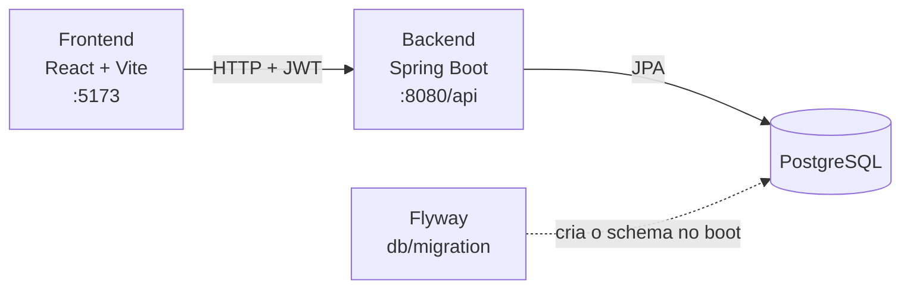

# SystemDmove

Sistema interno de gestão de projetos e produtividade da **Dmove**, inspirado no ClickUp. Organiza o trabalho em uma hierarquia de **workspaces, spaces, folders, lists e tarefas**, com visualização em lista e em quadro Kanban com arrastar e soltar. O projeto é dividido em uma API REST em **Java / Spring Boot** e uma interface em **React + Vite + TypeScript**, com banco **PostgreSQL** versionado por **Flyway**.

> Fase atual: fundação (autenticação, hierarquia e tarefas com as visões List e Board).

## Tecnologias


- **Backend:** Java 17, Spring Boot 4, Spring Security (JWT com jjwt + BCrypt), Spring Data JPA / Hibernate, Bean Validation, Lombok, Maven
- **Banco de dados:** PostgreSQL com migrations Flyway (o Hibernate apenas valida o schema)
- **Frontend:** React 19, Vite, TypeScript, TanStack React Query, React Router, Axios, dnd-kit (arrastar e soltar), date-fns, oxlint

## Funcionalidades

- Cadastro e login com JWT; senhas armazenadas com BCrypt.
- Workspaces com membros e papéis (`OWNER`, `ADMIN`, `MEMBER`); acesso aos recursos validado por workspace.
- Hierarquia Workspace → Space → Folder → List, navegável pela barra lateral.
- CRUD de tarefas com status (`TO_DO`, `IN_PROGRESS`, `IN_REVIEW`, `DONE`), prioridade (`URGENT`, `HIGH`, `NORMAL`, `LOW`), responsável e data de vencimento.
- Busca de tarefas dentro de uma list.
- **List view** com reordenação por arrastar e soltar.
- **Board view** (Kanban) com arrastar e soltar entre colunas de status.
- Painel lateral com os detalhes da tarefa.
- Tratamento centralizado de erros na API.
- Tema escuro com acentos roxo e azul.

O schema já prevê comentários, anexos, tags e notificações, que serão expostos nas próximas iterações.

## Arquitetura



O backend segue camadas `controller` → `service` → `repository`, com DTOs separados das entidades e um filtro JWT que identifica o usuário em cada requisição.

### Principais endpoints

Todas as rotas, exceto `/api/auth/**` e `/api/health`, exigem o header `Authorization: Bearer <token>`.

| Método | Rota | Descrição |
|---|---|---|
| POST | `/api/auth/register` | Cria conta |
| POST | `/api/auth/login` | Login, retorna `{ token, user }` |
| GET | `/api/auth/me` | Dados do usuário logado |
| GET/POST | `/api/workspaces` | Lista / cria workspaces |
| GET/POST | `/api/workspaces/{id}/members` | Lista / adiciona membros |
| GET/POST | `/api/workspaces/{id}/spaces` | Spaces do workspace |
| GET/POST | `/api/spaces/{id}/folders` | Folders do space |
| GET/POST | `/api/spaces/{id}/lists` | Lists do space |
| GET/POST | `/api/lists/{id}/tasks` | Tarefas da list (`?search=` para buscar) |
| GET/PUT/DELETE | `/api/tasks/{id}` | Consulta, edita ou exclui uma tarefa |
| PATCH | `/api/tasks/{id}/move` | Move / reordena (`{ status, position }`) |

Workspaces, spaces, folders e lists também têm `PUT` e `DELETE` por `id`.

## Como executar

Pré-requisitos: **Java 17+**, **Node.js** e **PostgreSQL** (local ou via Docker).

### 1. Banco de dados

```sql
CREATE DATABASE systemdmove;
```

Ou com Docker:

```bash
docker run --name systemdmove-pg -e POSTGRES_DB=systemdmove \
  -e POSTGRES_PASSWORD=postgres -p 5432:5432 -d postgres:16
```

### 2. Backend (http://localhost:8080)

```bash
cd backend
./mvnw spring-boot:run        # Windows: mvnw.cmd spring-boot:run
```

O Flyway cria todas as tabelas no primeiro boot (`backend/src/main/resources/db/migration/V1__init.sql`).

Variáveis de ambiente (opcionais; os padrões de desenvolvimento estão em `application.properties` e há um modelo em `backend/.env.example`):

| Variável | Descrição |
|---|---|
| `DB_URL` | URL JDBC do PostgreSQL |
| `DB_USERNAME` / `DB_PASSWORD` | Credenciais do banco |
| `APP_JWT_SECRET` | Segredo do JWT em Base64 (mínimo de 32 bytes; obrigatório definir em produção) |
| `APP_JWT_EXPIRATION_MS` | Validade do token em milissegundos |
| `APP_UPLOAD_DIR` | Pasta de anexos |
| `SERVER_PORT` | Porta da API |

### 3. Frontend (http://localhost:5173)

```bash
cd frontend
npm install
npm run dev
```

A URL da API é configurável por `VITE_API_URL` (padrão `http://localhost:8080/api`). Outros scripts: `npm run build`, `npm run lint` e `npm run preview`.

## Estrutura do projeto

```
SystemDmove/
├── backend/                         # API Spring Boot
│   └── src/main/java/com/systemdmove/
│       ├── config/                  # Spring Security e filtro JWT
│       ├── controller/              # endpoints REST
│       ├── service/                 # regras de negócio e controle de acesso
│       ├── repository/              # repositórios JPA
│       ├── model/                   # entidades e enums
│       ├── dto/                     # objetos de entrada e saída
│       ├── exception/               # tratamento global de erros
│       ├── session/ · util/         # usuário autenticado e utilitário JWT
│   └── src/main/resources/db/migration/   # migrations Flyway
├── frontend/                        # interface React
│   └── src/
│       ├── pages/                   # login, cadastro e app
│       ├── components/              # layout, tarefas e visões List/Board
│       ├── context/AuthContext.tsx
│       └── services/                # cliente HTTP e endpoints
└── banco-de-dados/                  # documentação do banco (schema via Flyway)
```

Tabelas: `users`, `workspaces`, `workspace_members`, `spaces`, `folders`, `lists`, `tasks`, `task_comments`, `task_attachments`, `tags`, `task_tags` e `notifications`.

## Próximas iterações

Visão de calendário, dashboard, notificações, filtros avançados, comentários, tags coloridas, convite de membros e anexos.

## Autor

Bruno Spinelli — [GitHub](https://github.com/brunospinelli08)

---

Projeto desenvolvido para a Dmove.
